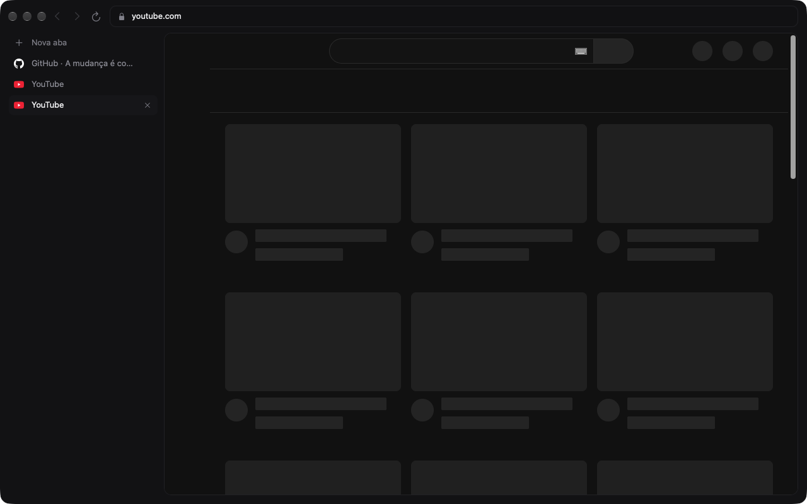
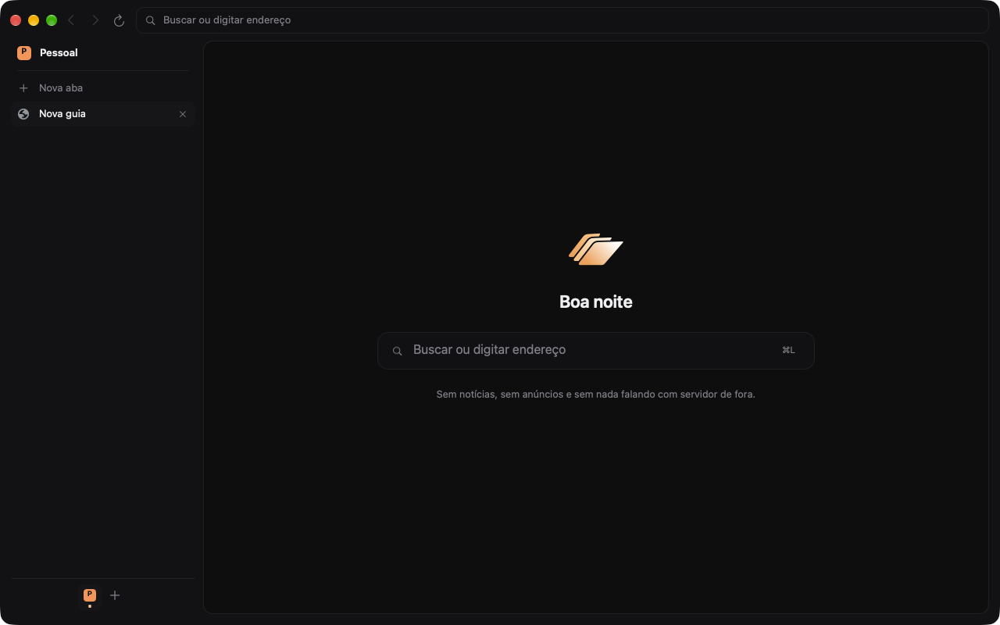
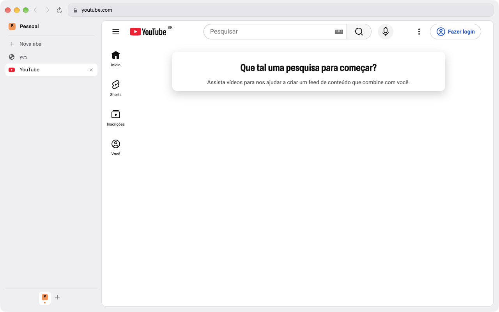
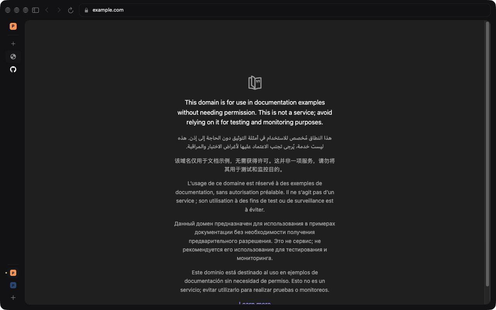

# A casca (interface) do navegador



| Nova aba (escuro) | Modo claro |
|---|---|
|  |  |

Decisão de 09/11 (issue #44): a interface é **nativa**. AppKit hoje e SwiftUI depois no Mac, WinUI no Windows. Não é HTML. O PoC está em `docs/poc/c1.md`.

## As três camadas

```
interface (AppKit/Swift)      chrome/browser/agens/ui/       barra, abas e cartão da página; amanhã, o Agens
        │  só enxerga ↓
API em C (embed/)             chrome/browser/agens/embed/agens_embed.h
        │
cola comum (C++)              chrome/browser/agens/embed/agens_window.h, native_shell.cc
        │
hospedeiro por sistema        chrome/browser/agens/embed/native_shell_mac.mm (Windows: _win.cc)
        │
janela do Chromium            WebUIBrowserWindow (Webium), sem a página HTML
```

- **Interface:** `ui/chrome_mac.mm` só importa AppKit e `agens_embed.h`. Segue o protótipo `prototipos/janela.html` com abas na lateral e o Grafite escuro: barra de 52 pt (voltar, avançar, recarregar/parar, endereço num poço com cadeado e sugestões), abas com favicon, carregando e dormindo, o ato atual no topo da coluna e a fileira de atos no pé, a página num cartão de 12 pt e a nossa nova aba (logo, saudação e busca). Claro e escuro seguem o sistema; os tokens ficam em `Token` no topo do arquivo. Não usa nenhum tipo do Chromium, então pode ir para o `BrowserKit` (Swift) sem mudar nada.
- **API (`agens_embed.h`):** C puro, para o Swift importar direto. Tem:
  - abas, com observador (título, URL, favicon, ativa, carregando, dormindo, voltar/avançar possíveis) e as ações nova aba, ativar, fechar, navegar (endereço ou busca), voltar, avançar, recarregar e parar;
  - sugestões do endereço, só de fontes locais (histórico, favoritos, atalhos e a busca do que foi digitado). As sugestões remotas de busca seguem desligadas, como o ungoogled deixa;
  - atos (um perfil do Chromium cada): lista com observador, trocar e criar. Trocar abre a janela do outro ato no lugar desta;
  - importar de outro navegador (`agens_import.h`): `agens_import_sources` lista cada perfil achado neste Mac (Chrome, Brave, Arc, Edge, Vivaldi, Opera e Chromium, um item por perfil; Safari; Firefox, um por perfil) com o que dá para trazer (`available`) e o que bloqueia (`note` + `problem`: Acesso Total ao Disco no Safari, senha principal no Firefox). `agens_import_start(ato_id, source_id, itens, fn, ctx)` importa no ato com esse id (vazio cria o ato sugerido, "Chrome — Pessoal") e manda, na thread da interface, início e fim de cada item (com a contagem e o erro), depois um só de pronto, falhou ou cancelado; `agens_import_cancel(job)` para no próximo passo. O tipo do erro (`kAgensImportError*`: origem sumiu, ato sumiu, Acesso Total ao Disco, Keychain negado, senha principal) deixa a interface explicar. Itens: favoritos, histórico (o Chromium descarta o que tem mais de 90 dias), senhas, cookies e extensões (só família Chromium: as mesmas da Chrome Web Store, instaladas da loja). Senhas e cookies da família Chromium pedem uma vez a chave "<Navegador> Safe Storage" do Keychain (a folha do macOS é o consentimento da pessoa). Safari: favoritos, histórico e cookies, com Acesso Total ao Disco; senhas não (a Apple não deixa; exportar CSV no app Senhas). Firefox: favoritos, histórico, cookies e senhas (sem senha principal). Não importa mecanismo de busca, formulários nem abas abertas. São leitores nossos, não o importador do Chromium: no Mac ele só conhece Safari e Firefox. `agens_import_run` (por nome de ato) segue para a interface atual. Gate: `embutido.sh` monta um Chrome e um Brave falsos numa casa temporária (`CFFIXED_USER_HOME` e `--agens-import-test-*`, só build de dev) e confere a lista, os eventos e o que chegou no ato;
  - os ganchos da interface: `agens_ui_create_chrome`, `agens_ui_layout` (diz onde fica a página), `agens_ui_colors` (as cores que o motor pinta atrás), `agens_ui_focus_address` e `agens_ui_destroy_chrome`; e `agens_window_relayout` para a interface pedir nova pintura ao trocar claro/escuro.
- **Cola comum** (`agens_window.h`, `native_shell.cc`): implementa a API sobre o Chromium (abas, sugestões, atos, buscador padrão, favoritos). Não tem nada de Mac: o Windows usa a mesma.
- **Hospedeiro por sistema** (`native_shell_mac.mm`): põe a interface por cima da janela, a aba ativa onde a interface mandar e a âncora dos balões do Chromium (o ícone do site).
- **Janela:** a da Webium. O Chromium já reconhece essa "janela sem Views" em uns 20 pontos do núcleo, e uma cópia nossa obrigaria a mexer em todos eles. O nosso patch nela tem umas 20 linhas, atrás de `agens::IsNativeShellEnabled()`.

## Comportamentos

- **Buscador:** texto que não é endereço vai para o buscador padrão. Cada ato começa com o **DuckDuckGo**, mas só enquanto ninguém escolheu um buscador: depois da primeira escolha (a nossa ou a da pessoa em Configurações › Buscador), ela vale e não é mais trocada.
- **Lateral aberta ou recolhida:** o botão na barra e **⌘S** (como no Arc) alternam entre a coluna aberta (236 pt) e a faixa de ícones (40 pt). A escolha fica salva. O ⌘S deixa de ser "Salvar página como", que continua no menu Arquivo. No Windows o atalho será **Ctrl+S**, junto com a casca WinUI (ainda não existe).



- **Reordenar arrastando** (#53, protótipo `prototipos/janela-abas.html` #reordenar): segurar e arrastar uma aba. Ela sobe com a única sombra da casca (só enquanto está na mão), as outras abrem um vão com o fio âmbar no meio onde ela vai cair, e ao soltar ela assenta no vão em 200 ms. Sobre a grade das fixadas, o vão vira um ladrilho tracejado âmbar no lugar onde ela entra (a 5ª abre uma linha nova) e o balão diz "Soltar para fixar · vira ladrilho". Sobre outro ato no pé, o ato ganha o contorno âmbar e o balão diz "Mover para **X** · sai daqui, sem cookies": soltar abre o endereço numa aba nova daquele ato (com os cookies dele; a sessão não vai junto) e fecha esta. Se o ato não tem janela aberta, a janela dele abre (como ao trocar). Recolhida (40 pt), o nome da aba vai num balão ao lado. Perto do topo ou do fim da lista, ela rola. **⌥⌘↑ / ⌥⌘↓** movem a aba ativa um lugar, dentro da parte dela (fixadas ou não). Botão direito na aba › **Mover para o ato** faz o mesmo que soltar no ato. Com abas em cima, arrastar só reordena as pílulas não fixadas. Pela API: `agens_window_place_tab` (fixa ou desfixa e põe no lugar) e `agens_window_move_tab_to_ato`; cada aba tem `AgensTab.id`, estável enquanto ela vive, e a interface segue a aba por ele (o popover de volume, uma aba na mão), não pelo índice.
- **Abas que dormem** (#24, #dormir): a aba descartada mostra o favicon em cinza e apagado com uma lua pequena no canto, e o título no tom fraco. Parar o ponteiro 0,6 s numa aba abre o cartão ao lado da coluna: título, site e a memória ("Usando 410 MB" com a barrinha, contra 512 MB; ou "Dormindo · liberou 190 MB"), e embaixo o estado: "Dorme desde 14:02 · clique para acordar", "Dorme depois de 5 min sem uso" ou por que não dorme ("Tocando áudio · não dorme enquanto toca", câmera ou microfone, fixada, a aba aberta, site que nunca dorme). Clicar acorda: a página recarrega onde estava. A memória é o footprint do Chromium para a aba (o mesmo número do cartão de aba do Chrome, `TabResourceUsageTabHelper`), atualizado ao abrir o cartão; a liberada é a estimativa guardada quando ela dormiu. Botão direito: **Pôr para dormir agora · libera ~N MB** (apagado com o motivo quando não pode) e **Nunca pôr <site> para dormir** (ou "Deixar <site> dormir de novo"), que mexe na lista de Configurações › Abas que dormem › Sites que nunca dormem. Lá também: **Mostrar a memória no cartão da aba** (ligado). Pela API: `AgensTab.memory_kb`, `slept_at`, `agens_window_sleep_tab`, `agens_window_refresh_memory`.
- **Uma janela só para os atos:** cada ato é um perfil do Chromium com a própria janela, mas a pessoa vê uma janela. Trocar de ato (no pé, **Abrir** no botão direito, criar ato, apagar o ato da própria janela, ou soltar uma aba num ato sem janela) põe a janela do outro ato no quadro desta (posição, tamanho, tela cheia; no Space atual), ela vira a janela da frente e esta se esconde (`orderOut`, não fecha: as abas seguem vivas ou dormem pelas regras). Voltar faz o mesmo ao contrário, então mover ou redimensionar vale para todos na próxima troca. Escondida, a janela sai do ⌘\`, do menu Janela, do Mission Control e do Dock; se ela voltar por outro caminho (clique numa notificação, um site que se foca), toma o lugar da janela da frente do mesmo jeito. Fechar a janela visível (⌘W na última aba, botão vermelho) fecha só a daquele ato e não mostra outra: o app fica aberto como no Chrome, e o Dock ou ⌘N abrem de novo o ato usado por último. Ao abrir o app, só o ato que estava na frente volta (`ProfileManager::GetLastOpenedProfiles` filtra pelo último usado); as abas dos outros ficam na sessão deles e voltam quando a pessoa troca para eles. ⌘N continua abrindo outra janela visível do mesmo ato. No modo embutido nada disso muda. Em `AgensWindow::PlaceOver` e `ShownAgain`.
- **Atos que dormem** (#23, #ato): no pé, ato dormindo = monograma apagado com a lua no canto (também na coluna recolhida). Parar o ponteiro num ato mostra o balão "Pessoal · dormindo · 0 MB · 2 abas" ou "Cliente A · acordado · 512 MB · 3 abas" (sem a contagem quando o ato nem foi carregado). Botão direito no ato: o cabeçalho com abas e memória, **Abrir**, **Configurar ato…** e **Pôr o ato para dormir · libera N MB** (apagado no ato em uso, que nunca dorme); depois, o balão "Cliente A foi dormir · liberou 512 MB" por 2 s. Trocar para um ato dormindo mostra "Acordando Pessoal · abrindo só a aba da frente" sobre a página até a aba da frente carregar (no máximo 4 s); as outras abas aparecem dormindo. "Dormindo" (`AgensAto.asleep`) é: o perfil não está carregado, ou o sono de ato do motor (`agens::IsAtoSleeping`, o mesmo `sleeping` do protocolo: nenhuma aba com página viva). Um ato sem aba à vista pelo tempo de Configurações (10 min de início) dorme sozinho e a lua aparece na próxima atualização dos atos (a medição de memória roda a cada 2 min). **Pôr o ato para dormir** usa `agens::SleepAto`, o mesmo caminho da regra dos 10 min: as abas que perderiam algo (áudio, câmera, formulário editado...) ficam acordadas. Trocar de ato acorda só a aba da frente por `agens::WakeTab`, o mesmo que o `view.attach` usa. `AgensAto.tabs` e `memory_kb` dão o balão. **Nunca pôr para dormir** (no mesmo menu, marcado quando ligado) tira o ato da regra dos 10 min e do "dormem inteiros"; o **Pôr o ato para dormir** continua valendo nele. Fica em `agens.atos[<pasta>].never_sleep` (Local State); pela API, `AgensAto.never_sleep` e `agens_window_set_ato_never_sleep`. **Apagar ato…** (o último item) abre a folha "Apagar o ato X?", que diz que as abas, os logins, as senhas, o histórico, os favoritos, a lista de downloads e as extensões daquele ato saem deste Mac (os arquivos baixados ficam) e que não dá para desfazer; **Cancelar** é o botão padrão (Return) e **Apagar ato** é o destrutivo. Nada é apagado sem a folha. Por baixo é a exclusão de perfil do Chromium (`DeleteProfileHelper`), que fecha as janelas do ato e apaga a pasta; apagar o ato da própria janela abre antes a janela do ato vizinho no lugar. O único ato não pode ser apagado (o item fica apagado: "é o único ato"). Pela API: `agens_window_delete_ato`.
- **Ajustes dos atos que dormem** (Configurações › Abas que dormem, grupo **Atos**, protótipo `prototipos/janela-tela.html` #dormir): **Atos fora de uso dormem depois de** 5 min, 10 min, 30 min, 1 h ou **Nunca** (`agens.atos_sleep_after_min`, 0 = nunca, 10 de início; na janela estreita os botões descem para baixo do texto); **A aba ativa e as fixadas também dormem** (`agens.atos_sleep_active_pinned`, ligado) e **Atos fora de uso dormem inteiros** (abaixo). Em **Nunca**, os dois interruptores ficam apagados e travados. Embaixo, **Atos que nunca dormem sozinhos**: a mesma lista do "Nunca pôr para dormir" do menu do ato, com **Remover** em cada um e um botão por ato para acrescentar. As três preferências ficam no Local State e o motor as lê na próxima passada da regra (≤ 1 min).
- **Atos fora de uso dormem inteiros** (Configurações › Abas que dormem, ligado, como no protótipo #ato/Desempenho): o ato que a regra dos 10 min pôs para dormir também sai da memória: as janelas dele fecham e o perfil descarrega (`AgensAto.asleep`, a lua). As abas ficam na sessão do ato (fechar a última janela de um perfil não apaga a sessão) e voltam quando ele é aberto de novo, na janela que abre: pelo "Continuar de onde parou" do Chromium quando é essa a escolha de Ao abrir do ato, e senão pelo nosso `SessionRestore` (o mesmo do `view.restore`), que troca a "Nova aba" em branco pelas abas. Não descarrega ato com download em andamento (a janela pediria confirmação para fechar) nem ato com "Nunca pôr para dormir". Só no AgensBrowser sozinho: no modo embutido as janelas são do hospedeiro, e o ato que dorme continua carregado (`sleeping`, como em [protocolo.md](protocolo.md)). Preferência `agens.atos_sleep_whole` (Local State).
- **Animações da lateral** (#50, #anim): tudo em 200 ms com a curva de saída do Agens, e na hora com "Reduzir movimento" do sistema. ⌘S anima a largura (236 ⇄ 40 pt) e os nomes somem na metade; abrir uma aba faz as de baixo descerem e a nova entrar da esquerda; fechar faz ela sair para a esquerda esmaecendo e as de baixo subirem; trocar de ato faz o título, as fixadas e a lista da janela do ato novo deslizarem 16 pt vindo do lado onde o ato está no pé.
- **Abas em cima ou na lateral:** **⌘⇧S** ou Configurações › Aparência › Abas. Em cima: as abas viram pílulas numa faixa ao lado dos semáforos, com o "+" no fim, e os atos vão para a barra, antes do menu. A escolha vale para todas as janelas e fica salva.
- **Abas fixadas:** botão direito na aba › Fixar aba. Na lateral aberta, viram ladrilhos de 4 por linha acima da nova aba; recolhida, ícones; em cima, pílulas só com o ícone. Ficam sempre no começo (regra do Chromium). Arrastar uma aba para a grade fixa (vira ladrilho); arrastar um ladrilho para a lista desfixa.
- **Som** (protótipo `prototipos/busca.html`, #som): aba tocando mostra o alto-falante na aba e no endereço; clicar silencia (fica laranja e cortado) ou devolve o som. Também pelo botão direito na aba. **Volume por aba:** parar o ponteiro 0,5 s no alto-falante da aba abre o popover com a seta: "Volume desta aba 60%", o alto-falante (silencia) e o controle de 0 a 100%, e "Silenciar esta aba". O popover fica preso à aba (não ao lugar dela na lista): fechar uma aba acima move o popover junto. O volume fica com a aba até ela fechar (não é guardado) e vale para todo som da página; no VoiceOver é a ação "Volume da aba" do alto-falante. O alto-falante do endereço (protótipo `prototipos/janela-traduzir.html`, #som) fica no começo, antes do cadeado, e abre o mesmo popover com a seta nele (não silencia mais); clicar de novo fecha. Com a navegação por teclado do macOS ligada, o Tab chega nele: ↓ (ou Espaço) abre o popover com o foco no controle, e Esc fecha e devolve o foco. Abaixo de 50% o ícone tem uma onda só, no endereço e na aba; mexer no controle com a aba silenciada devolve o som; silenciada, o título diz "Sem som" e o botão "Ativar som". No motor, é um ganho por aba no serviço de áudio (o grupo de streams da aba, como o silenciar do Chromium); a captura da aba continua recebendo o som sem o ganho.
- **Buscar na página** (⌘F, ou "⋯" › Buscar na página…; protótipo `prototipos/busca.html`): a barra desce do topo da página, à direita, sem empurrar a página. Campo com "3 de 6", ↑ e ↓ (⇧↵ e ↵, ⌘⇧G e ⌘G), **Aa** para diferenciar maiúsculas e × (esc também). Sem ocorrência, o contador diz "Nenhum resultado", a borda do campo fica vermelha e ↑↓ apagam. A busca de verdade é do Chromium (`FindTabHelper`), que pinta as ocorrências; a barra dele não aparece.
- **Zoom** (⌘+ ⌘− ⌘0): um aviso curto "Zoom 125% · ⌘0 volta a 100%" no topo da página por 1,5 s e a pílula "125%" no fim do endereço enquanto o zoom do site for diferente de 100% (vale por site, como no Chrome). A pílula abre um popover com a seta apontando para ela: − / 125% / + e Redefinir. "⋯" › Zoom mostra o zoom atual e abre o mesmo popover. A bolha de zoom do Chromium não aparece.
- **Downloads** (protótipo `prototipos/janela-recursos.html`, #downloads): o botão só existe quando o ato teve download desde que a janela abriu. Entra à esquerda dos atos (com abas em cima) ou antes do menu, crescendo de 60% a 100% em 200 ms, e a seta desce duas vezes; nada abre sozinho. O anel em volta é o progresso de tudo o que está baixando, somado; o ponto âmbar diz que um download precisa de você (falhou ou é perigoso). O popover com a seta lista até 6: tipo do arquivo, nome, barra e "18,2 de 48 MB · 12 s" enquanto baixa (pausar, cancelar), "Pausado · …" (continuar, cancelar), "2,4 MB · há 4 min" quando termina (abrir; clicar na linha também abre; mostrar no Finder), "Falhou: a rede caiu em 61%" em âmbar (tentar de novo quando o Chromium consegue, tirar da lista). Arquivo perigoso fica preso num bloco âmbar com **Apagar** (o preenchido) e **Manter mesmo assim**, que pede um segundo clique ("Clique de novo para manter"). **Limpar lista** tira os que terminaram (os arquivos ficam); com a lista vazia o popover segue aberto e, ao fechar, o botão sai. Embaixo, "Abrir a pasta Downloads" (⌥⌘L sem download na sessão abre a pasta; com download, a lista). Cancelar tira da lista na hora.
- **URL do link** (#link): com o ponteiro num link, a bolha aparece colada no canto de baixo à esquerda da página, sem esquema, com o domínio em destaque e o caminho longo cortado no meio (o fim fica à vista); some 0,6 s depois de sair do link. Se o ponteiro chega perto dela, pula para o canto direito. Vem do sinal de status do Chromium (`UpdateTargetURL`).
- **Permissões** (#permissoes): o pedido de um site acende o ícone da permissão no fim do endereço, em laranja claro, e o popover desce dele: "<site> quer", o ato, o que o site vai poder fazer e os botões empilhados **Permitir esta vez**, **Permitir sempre** e **Não permitir** (sem "esta vez" onde o Chromium não tem, como notificações). Fechar sem escolher dispensa o pedido. Câmera ou microfone ligados: no endereço, a pílula com o ponto que pulsa e os ícones (abre Informações do site); na aba, os mesmos ícones antes do ×, em laranja claro. O cadeado vira o ícone de ajustes quando o site tem alguma permissão neste ato; o popover dele mostra o site, a conexão e o ato, um interruptor por permissão que o site já tem (ou usa agora), "Cookies e dados do site" (clicar apaga os deste site), **Redefinir permissões** (volta a perguntar) e **Todas as permissões dos sites…**. Compartilhar a tela tem o seletor nosso (abaixo).
- **Senhas** (#senhas): depois de um login, a chave aparece no fim do endereço e o popover "Salvar a senha de <site>?" desce dela uma vez, com o ato, usuário e senha (pontos) e **Nunca neste site** / **Salvar**. Fechar sem escolher deixa a chave, que abre de novo. Com foco num campo de usuário ou senha e alguma senha do ato para o site, a lista da casca desce colada no campo, sem seta (protótipo #senhas, "Sugestão sob o campo"): cada conta com o usuário e a senha em pontos, uma linha, **Gerenciar senhas…** (abre Configurações › Senhas salvas) e o pé "Senhas do ato X · ↑↓ ↵". Clique ou ↵ preenche, ↑/↓ andam e mostram a conta em prévia nos campos (o cinza do Chromium), Esc fecha, Tab preenche a escolhida e segue para o próximo campo. Quem decide quando a lista aparece, o que ela traz e como preenche continua sendo o Chromium (o `AutofillPopupController`); trocamos só a vista (`agens::CreateNativeAutofillPopup`, chamada de `AutofillPopupView::Create`), e só para senhas: endereços, cartões e o resto seguem com a lista do Chromium, e no modo embutido também. A lista nunca pega o foco: a página continua com ele, as teclas chegam pelo controlador e ↵ sem nada escolhido segue para a página (ou para a extensão). Convivência com gerenciadores de senha (1Password, Bitwarden, LastPass, Dashlane): com um deles ligado no ato, a lista abre **acima** do campo, porque eles abrem o menu deles embaixo; os dois nunca se cobrem e o menu da extensão funciona igual. Sem espaço acima, ela fica embaixo. A lista também sobe quando não cabe embaixo na página. Configurações › Senhas salvas abre nas senhas do ato da janela, com busca e, com mais de um ato, a troca de ato no topo (protótipo, "Configurações › Senhas"): dá para ver, copiar e apagar as senhas de qualquer ato sem abrir a janela dele. Um ato dormindo continua dormindo: só o arquivo de senhas dele ("Login Data") é aberto, lido e fechado de novo (apagar faz o mesmo), sem carregar o perfil, as abas ou as extensões; um ato acordado usa o próprio cofre de senhas. Pela API: `agens_passwords`, `agens_password_get` e `agens_password_remove` recebem o id do ato (`AgensAto.id`; vazio é o da janela). Em todos os atos, ver e copiar pedem o Touch ID (ou a senha do Mac), que vale 5 min; a senha mostrada some em 8 s e a copiada sai da área de transferência em 60 s (se nada foi copiado depois); apagar deixa **Desfazer** na linha até a próxima ação, sair da página ou fechar Configurações.
- **Reabrir aba fechada** (⇧⌘T, menu Arquivo do macOS ou "⋯"): a aba volta na mesma posição, ativa, na página e rolagem onde estava, com um contorno quente por 1 s. No "⋯" o item fica apagado quando não há o que reabrir neste ato.
- **Telas nossas no lugar das do Chromium:** ⌘, e o item Ajustes do menu do Mac abrem as nossas Configurações; Favoritos (página e barra, ⌘⇧B); busca na página (⌘F, ⌘G, ⌘⇧G) e zoom (veja acima); página de erro (sem internet, site não encontrado, não respondeu, bloqueado); pergunta de salvar ou atualizar senha; pedidos de permissão dos sites; o painel do cadeado (conexão, permissões do site, apagar dados do site); a lista de downloads; e a bolha da URL do link. Imprimir e os alertas das páginas (`alert`, login HTTP) continuam do Chromium.
- **Cantos e densidade:** os cantos seguem o tema (Grafite e Seu 1×, Vidro 1,3× e Brasa 1,45× com abas em pílula em cima). Densidade compacta (Configurações › Aparência) baixa a barra para 44 pt, a faixa de abas para 40 pt e as abas para 28 pt; os semáforos acompanham.
- **Conteúdo protegido** (Configurações › Privacidade, protótipo `prototipos/janela-drm.html` seção 2; a seção 1, o pedido na primeira vez, ficou de fora): **Permitir conteúdo protegido (Widevine)**, ligado (`agens.widevine.enabled`, Local State), e a linha **Componente**: "Não instalado", "Baixando…" (a página se atualiza a cada segundo enquanto baixa) ou "Instalado · versão X · Atualiza sozinho, do Google" com **Remover componente**. O download é sozinho, em segundo plano, na primeira abertura ([sem telemetria](sem-telemetria.md#widevine-conteúdo-protegido)). Desligar apaga o componente; ligar de novo baixa na hora. Pela API: `agens_widevine_status`, `agens_widevine_set_enabled`, `agens_widevine_remove`.
- **Cookies por ato:** Configurações › Atos tem, em cada ato, o interruptor **Compartilhar cookies** (vem desligado: "Os logins valem nos outros atos que também ligaram"). Os atos com ele ligado dividem os cookies entre si; os outros seguem isolados. O ladrilho do ato ganha "· cookies compartilhados" na dica. Só a pessoa liga ou desliga, aqui; o socket não muda isso. Ligar não desliga `login` nem o controle por agente (a folha de aprovação diz com quais atos o ato divide os cookies). Detalhes em [protocolo.md](protocolo.md).
- **Traduzir página, sem Google** (protótipo `prototipos/janela-traduzir.html`, #traduzir e #idiomas): Tradução da Apple no próprio Mac (framework Translation, macOS 15+); a tradução do Chromium (Google) continua desligada. Página carregada: o idioma vem do NaturalLanguage da Apple sobre o texto (até 4.000 caracteres; com pouco texto, o `lang` da página). Se não é o idioma preferido, não está em Nunca traduzir e a Apple traduz o par, aparece o ícone de tradução no fim do endereço (antes da estrela); o popover desce dele sozinho uma vez por site na sessão, só na janela da frente e sem outro popover aberto: "Esta página está em espanhol · Traduzir para português?" com **Nunca traduzir espanhol**, **Agora não** e **Traduzir**. Primeira vez do par: "Baixar o idioma espanhol?" com **Cancelar** e **Baixar**; o Baixar abre a janela de download da própria Apple (o framework não dá o progresso para desenharmos a barra do protótipo nem o tamanho) e, baixado, traduz sozinho. Traduzindo: o anel em volta do ícone é o progresso, a página fica esmaecida e o texto troca no lugar, de 24 em 24 trechos. Traduzida: ícone em laranja claro; o popover diz "Traduzida do espanhol" com **Mostrar original** (volta o texto de antes) e **Sempre traduzir espanhol** (aí a próxima página em espanhol traduz sozinha, se o idioma já está no Mac). Botão direito: **Traduzir para português** depois de Recarregar na página, e depois de Copiar numa seleção; na seleção a tradução aparece num balão embaixo dela, com **Copiar**, e a página não muda. Configurações › Idiomas: **Idioma preferido** (o destino da tradução e o Accept-Language: pt-BR, pt-PT, inglês ou espanhol; uma lista digitada antes continua lá como opção), Sempre traduzir e Nunca traduzir (com Tirar), **Idiomas baixados no Mac** (perguntados ao framework idioma por idioma; sem tamanho, que ele não informa) e **Abrir Ajustes** para apagar (só o macOS apaga). Antes do macOS 15 nada disso aparece; Configurações › Idiomas diz "Indisponível". Por dentro: `ui/translate_mac.swift` vira `libagens_translate.dylib` (ação GN com o `swiftc` das Command Line Tools: o toolchain do Chromium para Mac não tem Swift) nas `Libraries` do framework, que o `sign.sh` já assina; a casca carrega com `dlopen` e fala pelo runtime do Objective-C (`AgensTranslator`). No macOS 26+ o par já baixado traduz com `TranslationSession(installedSource:)`; no 15 e para baixar, a sessão vem de um `.translationTask` do SwiftUI numa vista transparente sobre o ícone. O texto sai e volta por scripts no mundo isolado de tradução do Chromium (`agens_window_run_script`), nó de texto por nó (uma frase partida por `<b>` ou link vai em pedaços; atributos como `placeholder` ficam); o item do menu é `agens_window_set_translate`. Listas nas prefs do ato `agens.translate.always` e `agens.translate.never`.
- **Compartilhar a tela** (protótipo `prototipos/janela-tela.html`, #tela): o `getDisplayMedia` de um site abre a nossa folha no lugar do seletor do Chromium, desenhada como a folha de aprovação (14 pt do topo da página, cantos arredondados, véu que segura os cliques) e só sobre a aba que pediu (trocar de aba esconde a folha; voltar mostra de novo). Cabeçalho "<site> quer ver sua tela" com o ato; abas **Tela inteira**, **Janela** e **Aba** (só as que o site aceita), cada uma com a grade de miniaturas (três por linha, duas na folha estreita; duas linhas à vista e o resto rola). Telas e janelas vêm das listas do Chromium (`NativeDesktopMediaList`, ScreenCaptureKit), atualizadas a cada segundo; as abas são só as do mesmo ato (`TabDesktopMediaList` filtra pelo perfil) e mostram o favicon, não um retrato da página. **Compartilhar o áudio** (ligado) aparece na tela inteira, quando o macOS dá o som do sistema, e na aba; na janela, a nota de que o macOS não manda o som de uma janela sozinha. **Compartilhar** fica apagado até escolher uma fonte; **Cancelar** é o preenchido e responde a Esc e Return. Sem a permissão de Gravação de Tela do macOS, as abas Tela inteira e Janela mostram o aviso com os três passos e **Abrir Ajustes do Sistema** (`x-apple.systempreferences:…?Privacy_ScreenCapture`, o preenchido, Return) e **Agora não**; o motor confere a permissão a cada segundo e a grade aparece sozinha quando ela vem (as listas de tela e janela só começam depois dela, para não disparar o pedido do macOS). A aba continua escolhível sem a permissão. Compartilhando: no endereço, a pílula da câmera ganha o ícone da tela (e o alto-falante se o áudio vai junto); na aba, o ícone da tela antes do ×, em laranja claro; e no pé da página da aba que compartilha, a barra "● Compartilhando a tela inteira / a janela X / a aba X com <site>" com **Trocar** e **Parar**. **Trocar** só aparece compartilhando uma aba: abre a folha só com as abas do ato e troca a aba compartilhada no lugar (o Chromium só troca de aba para aba). O resto é o fluxo do Chromium: `DisplayMediaAccessHandler`, a captura e o "esta aba" (`preferCurrentTab`), que continua com a confirmação do Chromium. Por dentro: `embed/agens_screen_share_mac.mm` (o `DesktopMediaPicker` e o `MediaStreamUI` nossos, ligados em `DesktopMediaPicker::Create` e em `CreateMediaStreamCaptureIndicatorUI`); pela API, `agens_ui_share_picker`, `agens_window_share_pick`, `_stop`, `_switch` e `AgensTab.sharing*`. No modo embutido nada disso muda: o pedido vai para o seletor do Chromium, que abriria preso à janela escondida do motor.
- **Folha de aprovação** (protótipo `prototipos/janela-recursos.html`, #folha): quando o socket precisa do OK da pessoa (um app conectando, `control.start`, uma sessão), a folha desenhada flutua sobre a área da página, a 14 pt do topo, com todos os cantos arredondados, sobre um véu que escurece a página e segura os cliques. Mostra o ícone do app (o do próprio app; sem caminho, a letra no ladrilho quente), a pergunta, o nome e o bundle id (ou o caminho do executável), o ato, a lista "Vai poder" e uma nota. Botões **Permitir**, **Permitir sempre** (só quando vale; nunca em `control.start`, que é só desta vez) e **Não permitir**, que é o preenchido e responde ao Return (a folha pode subir enquanto a pessoa digita). Fechar a janela com a folha aberta conta como **Não permitir**. Não fala de assinatura nem de Team ID. Na conexão, a lista diz o que a conexão dá de fato (ver e abrir os atos; o resto pede outra folha), e por isso não tem o chip do ato; no `control.start`, o motivo que o agente deu vem entre aspas e a lista diz com quais atos ele divide os cookies.
- **Pílula do agente:** quando um agente controla a aba mostrada no cartão (ativa ou do par da divisão), uma pílula aparece sobre a parte de baixo do cartão: a marca do agente na cor do ato, duas linhas ("<agente> está usando esta aba" e o motivo, ou o que o agente disse com `control.status`) e **Assumir**. Ao assumir, ela vira "Você está no controle", o botão vira **Devolver ao <agente>** e aparece a bolha de parar, que encerra o controle. Também desenha o ponteiro do agente (nome e último clique) sobre a página. Segue "Reduzir movimento" do sistema. As regras do que o agente pode fazer e o que acontece com as operações dele estão em [protocolo.md](protocolo.md), "Assumir e devolver".
- **Extensões** (protótipo `prototipos/extensoes.html`). Na barra, depois do endereço: as extensões fixadas, cada uma com o ícone que o botão dela mostra na aba ativa, o selo (número ou texto, na cor que a extensão escolheu) e o título como dica; depois o botão de extensões (a peça de quebra-cabeça), que só aparece quando o ato tem alguma. Ele abre o menu "Extensões do ato X": uma linha por extensão (clicar roda a extensão, como o botão dela) com **fixar** / **fixada** à direita, e **Gerenciar extensões…**. Fixar vale por ato e fica salvo. O popup da extensão cai do botão dela (ou do quebra-cabeça, para as não fixadas). Numa aba que um agente está usando, com "Extensões funcionam nas abas dos agentes" desligado, os botões ficam apagados e não fazem nada, com a dica "Desligada nesta aba". Botão de extensão que a própria extensão escondeu na aba também fica apagado.
- **Instalar uma extensão** (da loja ou de um arquivo): a folha mostra nome, versão, de onde vem, o que ela pode fazer e "Onde instalar": **Só no ato X** (padrão) ou **Em todos os atos**, com uma caixa por ato (o atual e os que já têm ficam marcados e travados; desmarque para deixar um de fora). O botão diz para onde vai ("Instalar no ato X", "Instalar em 3 atos"). "Todos" acorda os atos que dormem e instala em cada um na hora. A caixa de atos aparece sempre, desligada até escolher "Em todos os atos" (a folha do sistema não muda de altura depois de aberta). Depois de instalar, um cartão sob a barra diz "<nome> instalada" e oferece **Fixar na barra**; some sozinho em 10 s.
- **Configurações › Extensões:** uma linha por extensão do ato, com a versão, os atos onde está e de onde veio (".crx, sem atualizações", "pasta, ligada a ela"), **Opções** (quando tem; abre numa aba), **Remover…** (em mais de um ato, pergunta: "Remover do ato X" ou "Remover de todos os atos (N)") e o interruptor. Embaixo: **Instalar da Chrome Web Store** (abre a loja), **Adicionar de um arquivo** (um `.crx` ou uma pasta descompactada, pela janela de abrir do Mac; pergunta os atos como na instalação; não se atualizam sozinhas, e a pasta fica ligada ao lugar onde está), **Extensões funcionam nas abas dos agentes** (o mesmo `agent_extensions` do Agens) e **Atualizar extensões sozinhas**.
- **DevTools encaixado** (protótipo `prototipos/devtools.html`). **Inspecionar** (botão direito, o último item) e **⌥⌘I** abrem o DevTools dentro do cartão da página, do lado usado por último: **embaixo** (o padrão, 40% da altura) ou **à direita** (420 pt). A página encolhe, nada fica por baixo; a lateral de abas não muda. Entre os dois, um divisor de 1 pt (9 pt para pegar) que fica âmbar com uma alça ao passar o mouse e, arrastando, mostra o tamanho ("312 px · 42%"); para em 120 pt de DevTools e 200 pt de página. Sobre o DevTools, uma faixa nossa de 28 pt com "DevTools" e, no fim, **embaixo**, **à direita**, **janela própria** e **fechar** (o lado atual fica âmbar). A faixa fica acima do DevTools, e não dentro da faixa de abas dele, porque desenhar lá dentro seria mexer na página do DevTools. As opções de "Dock side" do menu ⋮ do próprio DevTools não aparecem: o lado é nosso. **⌥⌘I** abre e fecha. **Janela própria** põe o DevTools na janela do Chromium e a página volta ao tamanho cheio; a janela não tem a nossa faixa, então "⋯" › **Trazer o DevTools para a página** o devolve ao cartão (fechar e abrir de novo abre em janela, que passou a ser a escolha). Lado, tamanho de cada lado e a escolha de janela valem para todos os atos e ficam salvos (`AgensDevToolsDock`, `AgensDevToolsSide`, `AgensDevToolsHeight`, `AgensDevToolsWidth` nas preferências do app). Cada aba tem o seu DevTools; trocar de aba mostra o da aba nova (ou nenhum). Numa divisão de abas e com a página em tela cheia o DevTools encaixado fica escondido até sair dela. Os menus, listas e atalhos do DevTools funcionam como no Chrome: ele está na janela de verdade.
  - Pela API: `AgensTab.devtools` (0 sem, 1 no cartão, 2 em janela), `agens_window_devtools` (0 fecha, 1 para o cartão, 2 para a janela), e a casca responde `agens_ui_devtools_in_page` (onde um novo abre) e `agens_ui_devtools_layout` (divide o cartão e põe o divisor e a faixa).
- **Sem o seletor de perfis do Chromium:** com mais de um ato, o navegador abre direto no último usado; trocar de ato é pela coluna.
- **Muitas abas e atos:** a lista de abas rola entre "Nova aba" e o pé, com uma barra fina (some na lateral recolhida). O pé mostra até 6 atos (5 recolhida); além disso, "⋯" abre a lista completa, e o ato atual nunca sai do pé.
- **Barra:** estrela de favoritar dentro do endereço e menu "⋯" (Nova aba, Favoritos, Histórico, Configurações). Favoritos ainda abre a página do Chromium.
- **Páginas internas** (#21, #paginas): o endereço mostra `agens://`, com os nossos nomes: `agens://historico`, `agens://favoritos`, `agens://downloads`, `agens://sobre`, `agens://configuracoes`. Digitar qualquer um abre a página (os outros `agens://x` viram `chrome://x`); `chrome://` continua funcionando e aparece como `agens://`. `agens://configuracoes/desempenho` (e `/aparencia`, `/privacidade`…) abre a seção das Configurações. Ficam do Chromium, sem marca: DevTools, `agens://flags`, `agens://inspect`.
- **Histórico nativo** (⌘Y ou "⋯" › Histórico): busca, dias, abrir, remover um item e "Apagar histórico…" (vai para Configurações › Apagar dados). Por baixo, uma página em branco nossa, sem script.
- **Downloads em página** (digitar `agens://downloads`): os downloads do ato, com busca, as mesmas linhas e ações do painel e **Abrir a pasta**. Primeiro os desta janela, depois os de antes, do histórico de downloads do Chromium (o banco de histórico do ato, `DownloadHistory`), do mais novo ao mais velho. O painel e o botão continuam só com os desta janela; **Limpar lista** no painel tira só esses. Tirar uma linha da página tira o download do histórico (o arquivo fica). ⌥⌘L e os links do Chromium para downloads seguem abrindo o painel. Pela API, `AgensDownload.past` marca os de antes da janela.
- **Sobre** (`agens://sobre`, no lugar de `chrome://version`): a marca, "Navegador Agens", SugiyamaLabs, a pílula, versão (com a data do build, a do executável), Chromium, sistema e **Perfil** (a pasta do ato da janela, com `~`; `agens_window_ato_path`), **Copiar dados da versão**, **Licenças** (Configurações › Avisos de código aberto) e os créditos das listas do bloqueador (`agens_adblock_credits()`, com as licenças), com **Ver no Bloqueador**, que abre Configurações › Bloqueador. Lá os mesmos créditos ficam embaixo de "Listas". A seção Sobre das Configurações continua. Com o Sparkle ([Atualizações](#atualizações)) vem **Procurar atualizações…** ao lado de Licenças e a pílula diz **Atualiza pelo GitHub**; sem ele, **Sem atualização automática** (o "Atualizado" do protótipo o Sparkle não diz sem procurar).
- **Página de erro:** sem conexão diz "Confira o Wi-Fi ou o cabo. A página abre sozinha quando a rede voltar." (o recarregar automático do Chromium). Site não encontrado diz "Não achamos lineaer.app" e, quando o histórico do ato tem um site a uma ou duas letras de distância, "Você quis dizer **linear.app**?" com **Ir para linear.app**; sempre com **Buscar “lineaer”**.
- **Configurações nativas, sem abrir página do Chromium:** apagar dados de navegação (período e o que apagar), restaurar as configurações (volta buscador DuckDuckGo, início, permissões, idiomas e visual; logins, senhas, favoritos, histórico e extensões ficam), exceções por site (mudar ou tirar), extensões do ato (veja abaixo) e senhas salvas (busca, ver e copiar com Touch ID ou a senha do Mac, apagar, de qualquer ato). O resto vale para o ato da janela. Só os avisos de código aberto ainda abrem `chrome://credits`.

## Atualizações

O navegador sozinho se atualiza pelo **Sparkle 2**, com a interface padrão dele (`SPUStandardUpdaterController`): procura uma vez por dia e baixa e instala sozinho por padrão; a janela do Sparkle mostra a novidade e deixa a pessoa desligar. Do nosso lado só há duas entradas, que chamam o `checkForUpdates:` do Sparkle:

- o menu **AgensBrowser › Procurar atualizações…**, logo abaixo de "Sobre";
- o botão **Procurar atualizações…** em `agens://sobre` e em Configurações › Sobre (linha "Atualizações").

Como liga: o `release.sh` põe o `Sparkle.framework` e as chaves `SU*` no app ([build](build.md#release-e-atualizações-sparkle)). Na primeira janela da casca, `StartUpdates` (`native_shell_mac.mm`) carrega o framework de `Contents/Frameworks` em tempo de execução e cria o controlador, que vive até o app fechar; `agens_updates_available()` e `agens_updates_check()` (`agens_embed.h`) servem à casca. Sem o framework, o menu e o botão não aparecem.

Não liga nunca:
- no **motor embutido** (`--agens-embedded`): o Agens se atualiza inteiro, com o motor dentro;
- em **build dev** (não oficial), a não ser com `--agens-updates`.

A conexão diária com o GitHub está em [sem telemetria](sem-telemetria.md#atualizações).

## O que o Agens embute (e o que não)

O motor do navegador vai dentro do `Agens.app`, em `Contents/Helpers/`, e o Agens o abre como processo auxiliar (issues #58, #59). Esse modo se chama **embutido** (`--agens-embedded`) e é descrito em [agens.md](agens.md); o `BrowserKit` é o lado Swift, guiado em [kit.md](kit.md).

No modo embutido **a casca não desenha nada**: o motor roda sem ícone no Dock e sem janela na tela (a única exceção é a janela do DevTools que a pessoa pede em janela própria, em [protocolo.md](protocolo.md), "Passo 5.5"; encaixado, o DevTools é uma vista que o Agens desenha; pop-up de página e `chrome.windows.create` viram aba, e PiP, imprimir, apps da web, `mailto:` e os seletores de data e cor ficam recusados: a lista está em "Nenhuma outra janela", no mesmo arquivo). A janela da Webium continua existindo por baixo (as abas moram nela), mas nunca aparece (nem mostrar, ativar, maximizar, restaurar ou tela cheia). Barra de endereço, abas, atos, a pílula do agente e as folhas de aprovação são desenhados pelo Agens, que recebe os dados e os pedidos pelo socket: `approval.ask` no lugar da folha, `ui.ask` no lugar dos menus, diálogos, escolher arquivo, login HTTP, permissão do site e instalar extensão, e `view.tab` com o `control` da aba no lugar da pílula. A aba é mostrada pelo `context` da camada dela (`view.layer`), não por `remote_cocoa`, e a entrada volta pelo socket. Tudo isso está em [protocolo.md](protocolo.md), "host e view". A casca nativa descrita acima é só do AgensBrowser sozinho.

O kit cobre o miolo: **a página, as abas e os atos**. Configurações, temas, menu, nova aba, primeira instalação e bloqueador são do navegador e não entram no kit.

## Windows (issue #61)

O que já está pronto para ele:
- a API em C e a cola comum compilam em qualquer sistema e não usam nada de Mac;
- `IsNativeShellEnabled()` só liga no Mac, e a Webium só vem ligada por padrão no Mac. No Windows, até existir o hospedeiro, a janela continua a Views do Chromium;
- `CreateNativeShellView` e `FocusNativeLocationBar` têm versões vazias fora do Mac, para o build fechar.

O que o Windows precisa escrever:
1. `native_shell_win.cc`: o mesmo papel do `native_shell_mac.mm`, com a interface num HWND filho por cima da janela da Webium.
2. `chrome/browser/agens/ui/chrome_win.cc`: a interface em WinUI (Mica/Fluent), implementando os mesmos ganchos `agens_ui_*`.
3. Atalhos com Ctrl no lugar de ⌘ (Ctrl+S lateral, Ctrl+L endereço).

Depende do Chromium compilando no Windows (#3), que precisa de uma máquina Windows. **Isso não foi compilado no Windows ainda**: as versões vazias e os `#if` foram escritos, mas só testados no Mac.

## Flags

- No nosso build, `Webium` e `AgensNativeShell` vêm **ligadas por padrão**.
- `--disable-features=Webium` volta para a janela Views do Chromium. Serve para comparar e para medir.
- `--disable-features=AgensNativeShell` mostra a Webium em HTML do Chromium (só referência).

Patch: `chromium/patches/sugiyamalabs/native-shell.patch`.

## Por que a interface fica fora da área de conteúdo

No Mac, a área de conteúdo de uma janela do Chromium é *layer-hosting* e não desenha NSView filha. Por isso a interface é uma NSView irmã dela, do tamanho da janela, abaixo dos semáforos. Onde fica a página, ela deixa o clique passar (`hitTest:` devolve `nil`).

## Próximos passos

1. ~~Testar o embed fora do processo.~~ Feito, sem `remote_cocoa`: o motor embutido entrega o `context` da camada e o app de exemplo (`kit/apple/exemplo/`) mostra a aba e devolve a entrada pelo socket.
2. Atualizar a ADR 0014 do Agens com esta casca e o caminho do embed.
3. Continuar o protótipo: recolher a lateral, temas (Vidro, Seu), escolher claro/escuro/sistema nas configurações, atalhos na nova aba, favoritos, menu. (Configurar e apagar ato: feito.)
4. ~~A nova aba carregava a do Chromium por baixo da nossa.~~ Feito (#54): a nova aba não carrega página nenhuma e não tem renderer até a pessoa navegar.
