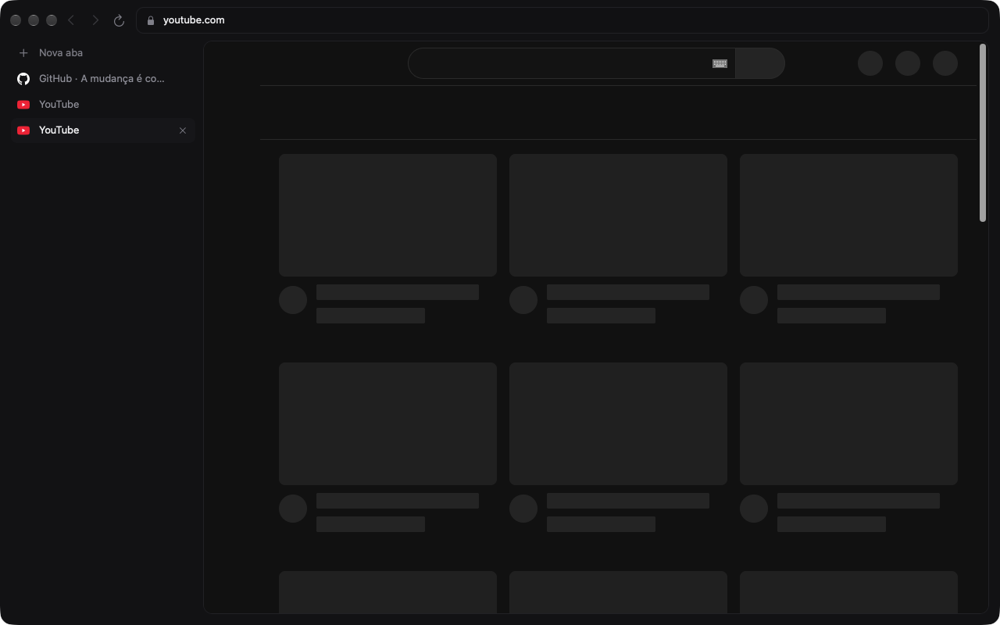
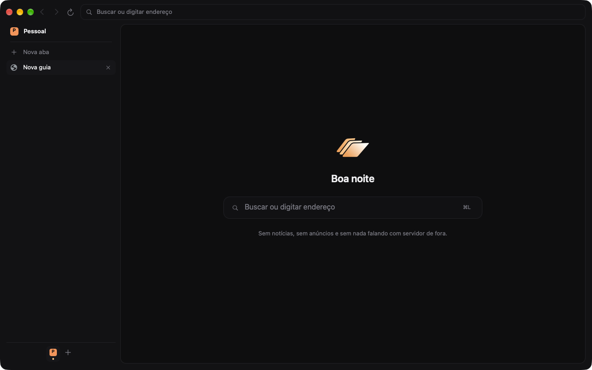
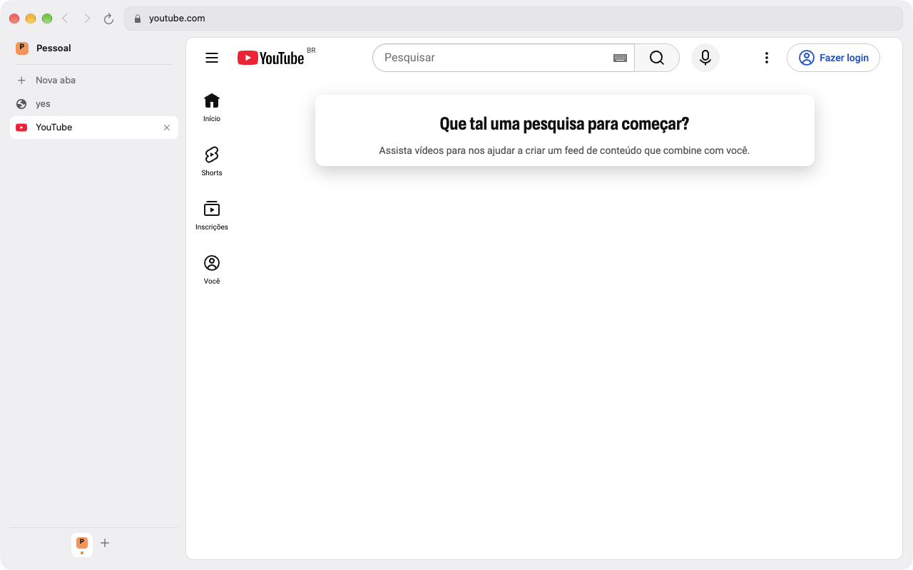
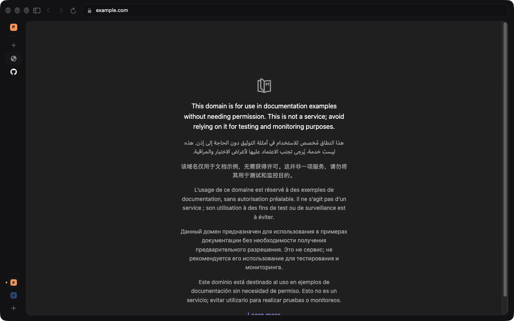

# A casca (interface) do navegador



| Nova aba (escuro) | Modo claro |
|---|---|
|  |  |

Decisão de 09/11 (issue #44): a interface é **nativa**. AppKit hoje e SwiftUI depois no Mac, WinUI no Windows. Não é HTML. O PoC está em `docs/poc/c1.md`.

## As três camadas

```
interface (AppKit/Swift)      chrome/browser/agens/ui/       barra, abas e cartão da página; amanhã, o Agens
        │  só enxerga ↓
API em C (embed/)             chrome/browser/agens/embed/agens_embed.h
        │
cola comum (C++)              chrome/browser/agens/embed/agens_window.h, native_shell.cc
        │
hospedeiro por sistema        chrome/browser/agens/embed/native_shell_mac.mm (Windows: _win.cc)
        │
janela do Chromium            WebUIBrowserWindow (Webium), sem a página HTML
```

- **Interface:** `ui/chrome_mac.mm` só importa AppKit e `agens_embed.h`. Segue o protótipo `prototipos/janela.html` com abas na lateral e o Grafite escuro: barra de 52 pt (voltar, avançar, recarregar/parar, endereço num poço com cadeado e sugestões), abas com favicon, carregando e dormindo, o ato atual no topo da coluna e a fileira de atos no pé, a página num cartão de 12 pt e a nossa nova aba (logo, saudação e busca). Claro e escuro seguem o sistema; os tokens ficam em `Token` no topo do arquivo. Não usa nenhum tipo do Chromium, então pode ir para o `BrowserKit` (Swift) sem mudar nada.
- **API (`agens_embed.h`):** C puro, para o Swift importar direto. Tem:
  - abas, com observador (título, URL, favicon, ativa, carregando, dormindo, voltar/avançar possíveis) e as ações nova aba, ativar, fechar, navegar (endereço ou busca), voltar, avançar, recarregar e parar;
  - sugestões do endereço, só de fontes locais (histórico, favoritos, atalhos e a busca do que foi digitado). As sugestões remotas de busca seguem desligadas, como o ungoogled deixa;
  - atos (um perfil do Chromium cada): lista com observador, trocar e criar. Trocar abre a janela do outro ato no lugar desta;
  - os ganchos da interface: `agens_ui_create_chrome`, `agens_ui_layout` (diz onde fica a página), `agens_ui_colors` (as cores que o motor pinta atrás), `agens_ui_focus_address` e `agens_ui_destroy_chrome`; e `agens_window_relayout` para a interface pedir nova pintura ao trocar claro/escuro.
- **Cola comum** (`agens_window.h`, `native_shell.cc`): implementa a API sobre o Chromium (abas, sugestões, atos, buscador padrão, favoritos). Não tem nada de Mac: o Windows usa a mesma.
- **Hospedeiro por sistema** (`native_shell_mac.mm`): põe a interface por cima da janela, a aba ativa onde a interface mandar e a âncora dos balões do Chromium (o ícone do site).
- **Janela:** a da Webium. O Chromium já reconhece essa "janela sem Views" em uns 20 pontos do núcleo, e uma cópia nossa obrigaria a mexer em todos eles. O nosso patch nela tem umas 20 linhas, atrás de `agens::IsNativeShellEnabled()`.

## Comportamentos

- **Buscador:** texto que não é endereço vai para o buscador padrão. Cada ato começa com o **DuckDuckGo**, mas só enquanto ninguém escolheu um buscador: depois da primeira escolha (a nossa ou a da pessoa em Configurações › Buscador), ela vale e não é mais trocada.
- **Lateral aberta ou recolhida:** o botão na barra e **⌘S** (como no Arc) alternam entre a coluna aberta (236 pt) e a faixa de ícones (40 pt). A escolha fica salva. O ⌘S deixa de ser "Salvar página como", que continua no menu Arquivo. No Windows o atalho será **Ctrl+S**, junto com a casca WinUI (ainda não existe).



- **Abas em cima ou na lateral:** **⌘⇧S** ou Configurações › Aparência › Abas. Em cima: as abas viram pílulas numa faixa ao lado dos semáforos, com o "+" no fim, e os atos vão para a barra, antes do menu. A escolha vale para todas as janelas e fica salva.
- **Abas fixadas:** botão direito na aba › Fixar aba. Na lateral aberta, viram ladrilhos de 4 por linha acima da nova aba; recolhida, ícones; em cima, pílulas só com o ícone. Ficam sempre no começo (regra do Chromium) e não se arrastam.
- **Som:** aba tocando mostra o alto-falante na aba e no endereço; clicar silencia (fica laranja e cortado) ou devolve o som. Também pelo botão direito na aba.
- **Telas nossas no lugar das do Chromium:** ⌘, e o item Ajustes do menu do Mac abrem as nossas Configurações; Favoritos (página e barra, ⌘⇧B); busca na página (⌘F, ⌘G, ⌘⇧G); página de erro (sem internet, site não encontrado, não respondeu, bloqueado); pergunta de salvar ou atualizar senha; pedidos de permissão dos sites; e o painel do cadeado (conexão, permissões do site, apagar dados do site). Imprimir e os alertas das páginas (`alert`, login HTTP) continuam do Chromium.
- **Cantos e densidade:** os cantos seguem o tema (Grafite e Seu 1×, Vidro 1,3× e Brasa 1,45× com abas em pílula em cima). Densidade compacta (Configurações › Aparência) baixa a barra para 44 pt, a faixa de abas para 40 pt e as abas para 28 pt; os semáforos acompanham.
- **Cookies por ato:** Configurações › Atos tem, em cada ato, o interruptor **Compartilhar cookies** (vem desligado: "Os logins valem nos outros atos que também ligaram"). Os atos com ele ligado dividem os cookies entre si; os outros seguem isolados. O ladrilho do ato ganha "· cookies compartilhados" na dica. Só a pessoa liga ou desliga, aqui; o socket não muda isso. Ligar não desliga `login` nem o controle por agente (a folha de aprovação diz com quais atos o ato divide os cookies). Detalhes em [protocolo.md](protocolo.md).
- **Folha de aprovação:** quando o socket precisa do OK da pessoa (um app conectando, `control.start`), a casca abre uma folha na janela com **Permitir**, **Permitir sempre** (só quando vale) e **Não permitir**. O Return responde **Não permitir**, porque a folha pode subir enquanto a pessoa digita em outro lugar. Fechar a janela com a folha aberta conta como **Não permitir**. É a folha simples do sistema; a folha desenhada fica para depois.
- **Pílula do agente:** quando um agente controla a aba mostrada no cartão (ativa ou do par da divisão), uma pílula aparece sobre a parte de baixo do cartão: a marca do agente na cor do ato, duas linhas ("<agente> está usando esta aba" e o motivo, ou o que o agente disse com `control.status`) e **Assumir**. Ao assumir, ela vira "Você está no controle", o botão vira **Devolver ao <agente>** e aparece a bolha de parar, que encerra o controle. Também desenha o ponteiro do agente (nome e último clique) sobre a página. Segue "Reduzir movimento" do sistema. As regras do que o agente pode fazer e o que acontece com as operações dele estão em [protocolo.md](protocolo.md), "Assumir e devolver".
- **Extensões** (protótipo `prototipos/extensoes.html`). Na barra, depois do endereço: as extensões fixadas, cada uma com o ícone que o botão dela mostra na aba ativa, o selo (número ou texto, na cor que a extensão escolheu) e o título como dica; depois o botão de extensões (a peça de quebra-cabeça), que só aparece quando o ato tem alguma. Ele abre o menu "Extensões do ato X": uma linha por extensão (clicar roda a extensão, como o botão dela) com **fixar** / **fixada** à direita, e **Gerenciar extensões…**. Fixar vale por ato e fica salvo. O popup da extensão cai do botão dela (ou do quebra-cabeça, para as não fixadas). Numa aba que um agente está usando, com "Extensões funcionam nas abas dos agentes" desligado, os botões ficam apagados e não fazem nada, com a dica "Desligada nesta aba". Botão de extensão que a própria extensão escondeu na aba também fica apagado.
- **Instalar uma extensão** (da loja ou de um arquivo): a folha mostra nome, versão, de onde vem, o que ela pode fazer e "Onde instalar": **Só no ato X** (padrão) ou **Em todos os atos**, com uma caixa por ato (o atual e os que já têm ficam marcados e travados; desmarque para deixar um de fora). O botão diz para onde vai ("Instalar no ato X", "Instalar em 3 atos"). "Todos" acorda os atos que dormem e instala em cada um na hora. A caixa de atos aparece sempre, desligada até escolher "Em todos os atos" (a folha do sistema não muda de altura depois de aberta). Depois de instalar, um cartão sob a barra diz "<nome> instalada" e oferece **Fixar na barra**; some sozinho em 10 s.
- **Configurações › Extensões:** uma linha por extensão do ato, com a versão, os atos onde está e de onde veio (".crx, sem atualizações", "pasta, ligada a ela"), **Opções** (quando tem; abre numa aba), **Remover…** (em mais de um ato, pergunta: "Remover do ato X" ou "Remover de todos os atos (N)") e o interruptor. Embaixo: **Instalar da Chrome Web Store** (abre a loja), **Adicionar de um arquivo** (um `.crx` ou uma pasta descompactada, pela janela de abrir do Mac; pergunta os atos como na instalação; não se atualizam sozinhas, e a pasta fica ligada ao lugar onde está), **Extensões funcionam nas abas dos agentes** (o mesmo `agent_extensions` do Agens) e **Atualizar extensões sozinhas**.
- **Sem o seletor de perfis do Chromium:** com mais de um ato, o navegador abre direto no último usado; trocar de ato é pela coluna.
- **Muitas abas e atos:** a lista de abas rola entre "Nova aba" e o pé, com uma barra fina (some na lateral recolhida). O pé mostra até 6 atos (5 recolhida); além disso, "⋯" abre a lista completa, e o ato atual nunca sai do pé.
- **Barra:** estrela de favoritar dentro do endereço e menu "⋯" (Nova aba, Favoritos, Histórico, Configurações). Favoritos ainda abre a página do Chromium.
- **Histórico nativo** (⌘Y ou "⋯" › Histórico): busca, dias, abrir, remover um item e "Apagar histórico…" (vai para Configurações › Apagar dados). A página do Chromium ainda carrega por baixo (um processo a mais).
- **Configurações nativas, sem abrir página do Chromium:** apagar dados de navegação (período e o que apagar), restaurar as configurações (volta buscador DuckDuckGo, início, permissões, idiomas e visual; logins, senhas, favoritos, histórico e extensões ficam), exceções por site (mudar ou tirar), extensões do ato (veja abaixo) e senhas salvas (busca, ver e copiar com Touch ID ou a senha do Mac, apagar). Tudo vale para o ato da janela. Só os avisos de código aberto ainda abrem `chrome://credits`.

## O que o Agens embute (e o que não)

O motor do navegador vai dentro do `Agens.app`, em `Contents/Helpers/`, e o Agens o abre como processo auxiliar (issues #58, #59). Esse modo se chama **embutido** (`--agens-embedded`) e é descrito em [agens.md](agens.md); o `BrowserKit` é o lado Swift, guiado em [kit.md](kit.md).

No modo embutido **a casca não desenha nada**: o motor roda sem ícone no Dock e sem janela na tela (a única exceção é a janela do DevTools que a pessoa pede, em [protocolo.md](protocolo.md), "Passo 5.5"; pop-up de página e `chrome.windows.create` viram aba, e PiP, imprimir, apps da web, `mailto:` e os seletores de data e cor ficam recusados: a lista está em "Nenhuma outra janela", no mesmo arquivo). A janela da Webium continua existindo por baixo (as abas moram nela), mas nunca aparece (nem mostrar, ativar, maximizar, restaurar ou tela cheia). Barra de endereço, abas, atos, a pílula do agente e as folhas de aprovação são desenhados pelo Agens, que recebe os dados e os pedidos pelo socket: `approval.ask` no lugar da folha, `ui.ask` no lugar dos menus, diálogos, escolher arquivo, login HTTP, permissão do site e instalar extensão, e `view.tab` com o `control` da aba no lugar da pílula. A aba é mostrada pelo `context` da camada dela (`view.layer`), não por `remote_cocoa`, e a entrada volta pelo socket. Tudo isso está em [protocolo.md](protocolo.md), "host e view". A casca nativa descrita acima é só do AgensBrowser sozinho.

O kit cobre o miolo: **a página, as abas e os atos**. Configurações, temas, menu, nova aba, primeira instalação e bloqueador são do navegador e não entram no kit.

## Windows (issue #61)

O que já está pronto para ele:
- a API em C e a cola comum compilam em qualquer sistema e não usam nada de Mac;
- `IsNativeShellEnabled()` só liga no Mac, e a Webium só vem ligada por padrão no Mac. No Windows, até existir o hospedeiro, a janela continua a Views do Chromium;
- `CreateNativeShellView` e `FocusNativeLocationBar` têm versões vazias fora do Mac, para o build fechar.

O que o Windows precisa escrever:
1. `native_shell_win.cc`: o mesmo papel do `native_shell_mac.mm`, com a interface num HWND filho por cima da janela da Webium.
2. `chrome/browser/agens/ui/chrome_win.cc`: a interface em WinUI (Mica/Fluent), implementando os mesmos ganchos `agens_ui_*`.
3. Atalhos com Ctrl no lugar de ⌘ (Ctrl+S lateral, Ctrl+L endereço).

Depende do Chromium compilando no Windows (#3), que precisa de uma máquina Windows. **Isso não foi compilado no Windows ainda**: as versões vazias e os `#if` foram escritos, mas só testados no Mac.

## Flags

- No nosso build, `Webium` e `AgensNativeShell` vêm **ligadas por padrão**.
- `--disable-features=Webium` volta para a janela Views do Chromium. Serve para comparar e para medir.
- `--disable-features=AgensNativeShell` mostra a Webium em HTML do Chromium (só referência).

Patch: `chromium/patches/sugiyamalabs/native-shell.patch`.

## Por que a interface fica fora da área de conteúdo

No Mac, a área de conteúdo de uma janela do Chromium é *layer-hosting* e não desenha NSView filha. Por isso a interface é uma NSView irmã dela, do tamanho da janela, abaixo dos semáforos. Onde fica a página, ela deixa o clique passar (`hitTest:` devolve `nil`).

## Próximos passos

1. ~~Testar o embed fora do processo.~~ Feito, sem `remote_cocoa`: o motor embutido entrega o `context` da camada e o app de exemplo (`kit/apple/exemplo/`) mostra a aba e devolve a entrada pelo socket.
2. Atualizar a ADR 0014 do Agens com esta casca e o caminho do embed.
3. Continuar o protótipo: recolher a lateral, temas (Vidro, Seu), escolher claro/escuro/sistema nas configurações, atalhos na nova aba, favoritos, menu, configurar e apagar ato.
4. A nova aba de verdade ainda carrega a do Chromium por baixo da nossa (um renderer a mais). Trocar por uma página vazia é um ganho de memória fácil.
