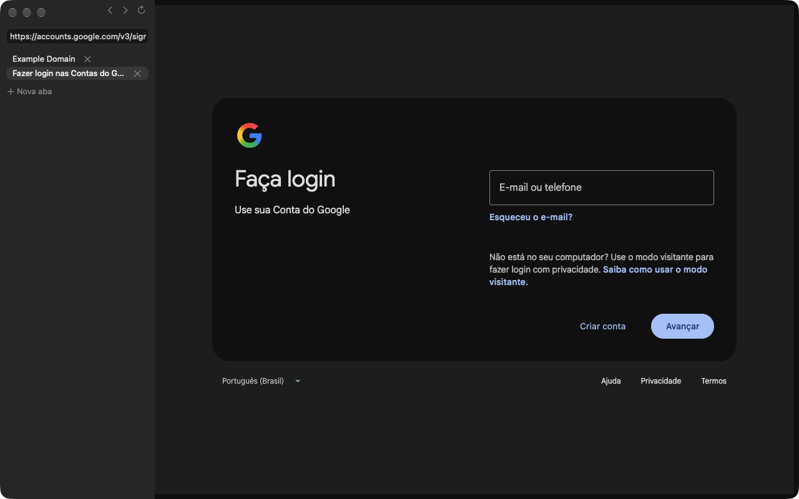

# Prova de conceito C1: lateral nativa em AppKit

Issue #44. Patch em `chromium/patches/poc/c1-native-shell.patch` (fora da `series`).

## O que é

A janela continua sendo a da Webium (`WebUIBrowserWindow`): comandos, atalhos do menu, diálogos e tela cheia vêm dela. Com a feature `AgensNativeShell`, a página `chrome://webui-browser` deixa de existir e no lugar entram:

- **uma lateral em AppKit** (`NSVisualEffectView`, `NSTextField`, `NSButton`, SF Symbols): voltar, avançar e recarregar, o campo de endereço com a busca do omnibox do Chromium, a lista de abas com botão de fechar e "Nova aba";
- **a aba ativa** num `views::WebView`, com 8 px de margem.

A lateral fica como irmã da área de conteúdo, no frame da janela. A área de conteúdo do Chromium no Mac é *layer-hosting* e não desenha NSView filha.

Para rodar: `--enable-features=Webium,AgensNativeShell`.

Arquivos:
- `chrome/browser/ui/webui_browser/agens_native_shell.h` e `agens_native_shell_mac.mm` (novos, ~300 linhas);
- `webui_browser_window.cc`: o código da página WebUI fica atrás da flag, com proteção de nulo quando ela não existe.

## Memória (build Dev, 1 aba example.com, mediana de 3)

| | Total | Processos | Renderers | Navegador |
|---|---|---|---|---|
| Views (padrão) | 385 MB | 7 | 147 MB | 99 MB |
| C1 AppKit | 253 MB | 6 | 76 MB | 84 MB |

O build Dev não serve para número absoluto (sem LTO nem PGO), só para comparar entre si. A economia vem de não ter o renderer da interface e de não carregar a interface Views.

## O que testei de verdade

- Abre e navega (example.com, accounts.google.com).
- Duas abas na mesma janela: a lista atualiza com título e aba ativa; trocar a aba ativa troca o conteúdo.
- Digitar num input da página (o campo de e-mail do login do Google recebe o texto).
- Abas que dormem: com `SleepingTabs:discard_after/20s`, a aba de fundo dormiu e, ao voltar, recarregou (`document.wasDiscarded = true`).
- Não houve crash nem CHECK no log durante os testes.

## O que não testei

- Cliques e atalhos de verdade (Cmd+T, Cmd+W, Cmd+L, clique na lista, Enter no campo de endereço). Os testes foram por DevTools, sem mouse nem teclado.
- Login completo no Google (não passei da tela do e-mail) e o 1Password.
- Build oficial, tela cheia, várias janelas, modo claro, VoiceOver.

## O que falta para ficar usável

- Favicon, carregando e áudio na lista de abas; arrastar para reordenar.
- Sugestões no campo de endereço: hoje ele só classifica o texto no Enter.
- Os demais itens do protótipo: atos, favoritos, histórico, temas, nova aba.
- Trocar o código provisório por SwiftUI (`NSHostingView`) se valer a pena.
- Windows: este caminho é só Mac. No Windows seria outra casca (WinUI).
