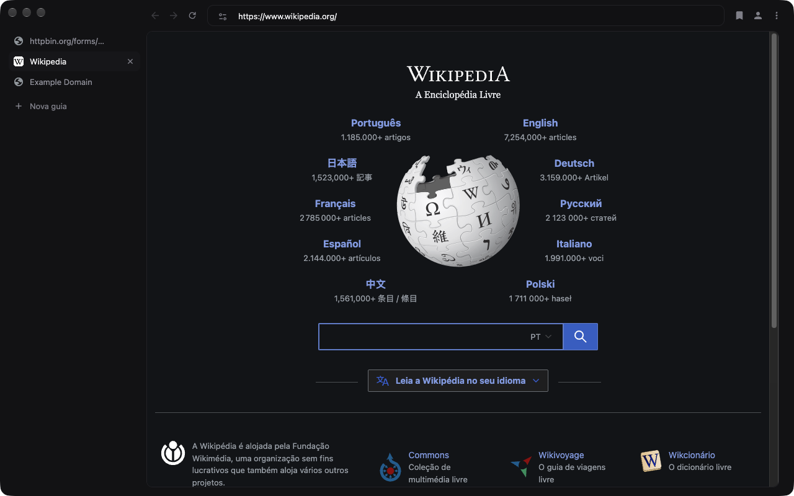

# PoC C2: interface nossa sobre a Webium

A Webium (`features::kWebium`, Chromium 156) desenha a janela como uma página WebUI (`chrome://webui-browser`). O C2 troca só o front-end dela: abas na lateral esquerda, barra de endereço em cima da página e o tema Grafite escuro do `prototipos/janela.html`. Nenhuma linha de C++.

## O que mudou

Patch: [`chromium/patches/poc/c2-webium.patch`](../../chromium/patches/poc/c2-webium.patch) (fora da `series`). Só `chrome/browser/resources/webui_browser/`:

- `app.html.ts` / `app.css`: grade de 2×2. Em cima ficam os semáforos e a barra (voltar, avançar, recarregar, endereço); embaixo, as abas (236 px) e a página num painel com borda e raio de 10 px. O Grafite entra redefinindo os tokens `--color-*` no `:host`, o que tematiza também a caixa de busca e as sugestões.
- `tab_strip/*`: lista vertical, aba de 32 px como a `.stab` do protótipo e botão "Nova guia" no fim da lista. A aba ativa com o clique (`onTabMousedown_`). O arrasto da Webium só funciona na horizontal e ficou desligado na lateral.
- Para ativar: `--enable-features=Webium`.

## Memória (build Dev, 1 aba example.com, `tools/measure.py`, mediana de 3, 60 s de espera)

| Processo | Views | C2 (Webium) |
|---|---|---|
| renderer | 139 MB | 131 MB |
| browser | 96 MB | 84 MB |
| gpu-process | 83 MB | 60 MB |
| utility:network | 28 MB | 28 MB |
| utility:storage | 21 MB | 21 MB |
| **total (footprint)** | **362 MB** | **320 MB (−12%)** |

Os dois casos têm 7 processos. O build Dev serve só para comparar um caso com o outro, não para número absoluto. No `measure.py`, a Webium entrou por um wrapper que passa `--enable-features=Webium`. Usei 60 s de espera em vez de 600 porque, com 1 aba, nada dorme.

## O que testei

O processo do agente não tem permissão de Acessibilidade no macOS, então teclado e mouse de verdade (System Events, CGEvent) não chegam ao app. Cliques e teclas foram enviados pelo DevTools Protocol ao alvo `chrome://webui-browser`. Eles passam pelo roteamento de entrada da WebUI até a página, mas não pelo menu do macOS.

| Critério | Resultado |
|---|---|
| 1. Abrir, navegar e digitar em input | ✅ Digitei URL na barra e dei Enter (httpbin.org/forms/post). Cliquei no campo da página e digitei "Ola mundo"; o valor chegou ao input. |
| 2. Abas pela lateral | ✅ "Nova guia", troca entre abas (ida e volta) e fechar pelo X, sempre com uma janela só. |
| 2. Cmd+T, Cmd+W, Cmd+L | ❌ Não testado. No Mac, esses atalhos vêm do menu do sistema e só disparam com evento real do teclado. Não mexi nesse caminho, mas falta conferir à mão. |
| 3. Login do Google | ✅ parcial. Passou da tela de e-mail sem o aviso de "navegador não seguro" e chegou à verificação de identidade. A conta usada pede chave de acesso primeiro (o diálogo nativo de passkey abriu), então a tela de senha não apareceu. |
| 4. Abas que dormem | ❌ **Quebra na Webium.** No Dev, ao descartar a aba, o navegador cai em `DCHECK(!embedder_frame_node_)` (`PageNodeImpl::OnAboutToBeDiscarded`: as abas da Webium são páginas com embedder). No build oficial não cai, mas também não descarta (`wasDiscarded=false` depois de 150 s com `discard_after/30s`). Controle: Views no mesmo build descarta (`wasDiscarded=true`). Não é coisa do patch C2 (só CSS/TS); é da Webium e exige C++ no performance_manager ou na Webium. |
| 5. Memória | ✅ tabela acima |
| 6. Screenshot | ✅ `c2.png` |

## Problemas e o que falta

- **Abas que dormem não funcionam com a Webium** (item 4). É o bloqueio principal.
- Pelo DevTools, `/json/new` abre uma janela nova por aba na Webium. O `measure.py` com a lista completa de abas mediria 10 janelas, então precisa abrir as abas pela linha de comando.
- Sem reordenar nem arrastar aba para fora da janela, sem grupos de abas na lateral e sem recolher a lateral.
- A nova aba continua sendo a do Chromium ("Nova guia"): o logo não entrou, porque o NTP fica fora de `webui_browser/`.
- A Webium ainda é experimental: o log enche de `NOTREACHED` em `WebUIBrowserWindow` (`UpdateToolbar`, `UpdateLoadingAnimations`, `GetStatusBubbles` etc.). Barra de status, animação de carregamento e vários diálogos não existem.
- Tema fixo no Grafite escuro, sem modo claro, sem atos e sem configurações.
