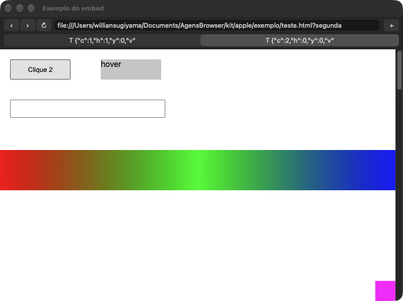

# Prova de conceito do embed: uma aba do navegador dentro de outro app

Issue #58. Estágio 1: leitura do código, implementação e compilação. Estágio 2: rodou, com teste automático. O que é fato lido no código, o que rodou e o que ainda é palpite está marcado.



## Veredito

**O caminho (b) funciona.** Um app Swift sem nenhum código do Chromium mostra a aba do motor, que roda em outro processo, e a página responde a clique, mouse, roda, teclado, troca de aba e redimensionamento. Funcionou na primeira execução, sem correção no motor, e continua funcionando com a janela do motor fora da tela.

- O `remote_cocoa` como o Chromium usa (app shim) **não serve para o Agens do jeito que está**: o processo que mostra a janela precisa carregar o framework inteiro do navegador e virar um processo do Chromium. É o que o plano descartou.
- O que serve é a metade de baixo do mesmo mecanismo: **a aba desenha num `CAContext` e outro processo mostra esse contexto num `CALayerHost`**, só com o número do contexto. Os eventos voltam pelo nosso socket.
- O motor ganhou ~660 linhas nossas e 2 linhas em arquivo do Chromium.
- Memória com duas abas abertas: app de exemplo **23 MB**, motor **355 MB** em 7 processos (build Dev). A memória do navegador fica toda fora do app.
- O que falta é trabalho conhecido, não risco de arquitetura: o que o motor abre por conta própria (menus, listas, balões) e o resto da lista "Atalhos assumidos".

## Como o app shim funciona (lido no código, Chromium 156)

1. **O shim carrega o framework inteiro.** `chrome/app_shim/app_mode_loader_mac.mm:189` faz `dlopen` do framework do navegador e chama a entrada `ChromeAppModeStart`, que roda `content::ContentMain` (`chrome_main_app_mode_mac.mm`). O `chrome/app_shim/README.md` diz o mesmo: o shim "merely loads the framework".
2. **O shim é dono do processo.** `AppShimMainDelegate::RunProcess` (`app_shim_main_delegate.mm`) exige que o `NSApp` seja `AppShimApplication` (um `CrApplication`, com `CrAppProtocol` e `CrAppControlProtocol`; há um `CHECK`), cria a thread de IO, inicia o mojo como broker e fica em `base::RunLoop().Run()`. Features, PartitionAlloc e ThreadPool são configurados ali.
3. **Conexão:** o shim acha o navegador por um nome Mach (`<bundle id>.apps.<hash da pasta de dados>`), manda uma ponta de canal (`AppShimController::ConnectToBrowser`) e o navegador confere o processo pelo audit token (`app_shim_host_bootstrap_mac.cc`). Depois disso é mojo, sem versão: os dois lados têm de ser do mesmo build.
4. **Quem cria o quê:** o navegador pede pelo `remote_cocoa.mojom.Application` (`components/remote_cocoa/common/application.mojom`): `CreateNativeWidgetNSWindow` (a janela inteira fica no shim), `CreateWebContentsNSView` e `CreateRenderWidgetHostNSView`. As vistas são encaixadas por id numa tabela do próprio processo (`WebContentsNSViewBridge::SetParentNSView` → `GetNSViewFromId`).
5. **Pixels:** o processo de GPU cria um `CAContext` (`ui/accelerated_widget_mac/ca_layer_tree_coordinator.mm:182`) e manda só o `ca_context_id`. Quem mostra cria um `CALayerHost` com esse id (`display_ca_layer_tree.mm`). Numa janela do shim os pixels chegam pela janela (`NativeWidgetNSWindow.SetCALayerParams`), porque a aba entra na camada da janela (`SetParentUiLayer`). Sem camada-mãe, a aba tem compositor próprio e manda o contexto dela (`BrowserCompositorMac::UpdateState` → `HasOwnCompositor`). É o caminho do content_shell e do modo headless.
6. **Entrada:** a `RenderWidgetHostViewCocoa` (3.100 linhas, `content/app_shim_remote_cocoa/`) roda no shim e fala `RenderWidgetHostNSViewHost` (`content/common/render_widget_host_ns_view.mojom`): mouse e roda como eventos do Blink, teclado como evento do Blink **mais o `NSEvent` serializado** (`ui::EventToData`, porque o evento reconstruído "não chega nem perto do original"), IME (`ImeSetComposition`, `ImeCommitText`, e chamadas síncronas para o retângulo do cursor), foco (`OnFirstResponderChanged`, `OnWindowIsKeyChanged`), tamanho (`OnBoundsInWindowChanged`).
7. **Acessibilidade:** troca de tokens (`GetRenderWidgetAccessibilityToken`, `NSAccessibilityRemoteUIElement`). A árvore fica no navegador.

## Os caminhos

| | (a) Agens faz o papel do shim | (b) só a camada remota + eventos | (c) janela do motor colada por cima |
|---|---|---|---|
| O que o Agens carrega | O framework do navegador (573 MB no build Dev), com `ContentMain`, alocador, mojo e `NSApplication` do Chromium | Nada do Chromium. Swift + `CALayerHost` (classe privada do QuartzCore) | Nada |
| Mudança no motor | Pequena: um `Application` remoto para o Agens e ligar as abas nele | Pequena: publicar o id do contexto e receber eventos (feito aqui) | Pequena: janela sem borda que segue o painel |
| Teclado, IME, cursor, arrastar | De graça, mantidos pelo Chromium | **Nossos.** Teclado e IME básicos feitos; cursor, arrastar e soltar, posição da janela do IME faltam | De graça |
| Menus e balões da página (`select`, contexto, autofill, permissão, extensão) | Funcionam: abrem no processo do Agens | Não têm janela para ancorar. Precisam vir como dados para o Agens desenhar (permissão já vem pela `agens_embed.h`) | Funcionam |
| Foco | Normal | Normal no Agens; o motor recebe "focou/desfocou" | Ruim: clicar ativa o outro app, a janela do Agens perde o destaque. Só resolve com painel não ativante e API privada de ordem de janelas |
| Redimensionar | Sincronizado pelo Chromium | Segue, mas sem sincronia de quadro (pode piscar; ver riscos) | Atrasa: duas janelas de processos diferentes |
| Várias abas em vários painéis | Sim | Sim: um contexto por aba visível | Uma janela por painel, ordem entre janelas frágil |
| Tela cheia | Do Chromium | Nossa (o Agens decide) | Frágil |
| Acessibilidade | De graça | A fazer, com os mesmos tokens | De graça |
| Rebase mensal | Patch pequeno, mas o `BrowserKit` passa a depender do build exato do motor (mojo sem versão) e do arranque do Chromium dentro do Agens | Patch pequeno e a fronteira é o nosso protocolo. O que acompanha o Chromium é a tradução de eventos (~200 linhas) | Patch pequeno |
| Um `CHECK` do Chromium derruba | O Agens | Só o motor | Só o motor |

**(d) Outras saídas que o código sugere:**
- Tirar só o `remote_cocoa` e as vistas para uma biblioteca pequena. Não é uma flag: esses arquivos fazem parte do alvo `//content/browser` (`content/browser/BUILD.gn:2691`) e puxam base, mojo, ui e blink. Vira um alvo novo para manter a cada rebase. Só vale se (b) empacar.
- Não existe API pública do macOS para mostrar a vista de outro processo. A privada (`NSRemoteView`) exige serviço XPC.

## Por que (b) primeiro

(Escrito antes de rodar. O ponto incerto abaixo foi respondido: sim.)

- É o único que respeita "o motor não roda dentro do Agens" de verdade. O (a) põe o Chromium dentro do Agens em tudo menos o nome.
- O ponto mais incerto de todos os caminhos é o mesmo: **um app de fora consegue mostrar o `CAContext` do nosso processo de GPU?** O (b) testa isso com o mínimo de peças. O shim do Chrome já faz isso com assinatura diferente da do navegador, então a expectativa é que sim.
- Se a entrada reimplementada se mostrar cara demais, (a) continua aberto e aproveita o mesmo motor.
- (c) fica como último recurso: funciona no primeiro dia e incomoda para sempre.

## O que foi implementado

**Motor** (`~/browser-work-3/…/src`, commits `809011e2c7` e `f4dd384bff`, 10 arquivos, 659 linhas; o diff está em `docs/poc/embed-engine.patch`):

- `content/public/browser/agens_embed_mac.h` e `content/browser/renderer_host/agens_embed_mac.mm`: o lado do navegador do contrato da `RenderWidgetHostViewCocoa`, sem mojo. Avisa a cada quadro o id do contexto da aba; recebe foco, mouse, roda, teclado (com o resultado do sistema de texto: texto inserido, comandos de edição, composição) e os comandos do menu Editar. Mouse, roda e tecla chegam como `NSEvent` serializado e passam pelos mesmos construtores de evento que o Chromium usa.
- `render_widget_host_view_mac.mm`: **1 linha** em `AcceleratedWidgetCALayerParamsUpdated` (mais o `#include`). É a única mudança em código do Chromium, além de 5 linhas em três `BUILD.gn`.
- `chrome/browser/agens/embed/embed_host_mac.cc`: o servidor da prova. Socket Unix `0600`, uma mensagem JSON por linha, um cliente. Só existe com `--agens-embed-socket=<caminho>`. Com `--agens-embed-hide-window`, tira a janela do motor da tela assim que o cliente mostra a página.
- `native_shell_mac.mm`: enquanto um cliente está ligado, a casca não põe a aba na janela dela. A aba fica sem janela, visível e no tamanho que o cliente pediu, e por isso desenha sozinha. Quando o cliente sai, a aba volta para a janela.

**App de exemplo** (`kit/apple/exemplo/`): `main.swift` (~550 linhas com o teste, AppKit puro), `build.sh`, e o teste automático: `autoteste.sh`, `teste.html` e `janelas.swift`. Janela com voltar, avançar, recarregar, endereço, "+", fileira de abas e a página. A vista da página repete a montagem de camadas do Chromium (`DisplayCALayerTree`) e implementa `NSTextInputClient`.

**Protocolo da prova** (provisório; o definitivo é o socket de `docs/agens.md`):

| Do app para o motor | |
|---|---|
| `attach {width,height}` / `resize {width,height}` | Liga na primeira janela; tamanho da página em pontos |
| `focus {on}` | A vista virou (ou deixou de ser) a que recebe teclado |
| `mouse {data,x,y}` / `mouse.leave` / `wheel {data,x,y}` | `data` é o `NSEvent` (`CGEventCreateData`, base64); `x,y` a partir do canto de cima |
| `key {data,text,commands,marked,sel_start,sel_end,had_marked,unmarked}` | A tecla e o que o `interpretKeyEvents:` fez com ela |
| `edit {command}` | `cut`, `copy`, `paste`, `selectAll`, `undo`, `redo` |
| `navigate {text}`, `tab.new`, `tab.activate {index}`, `tab.close {index}`, `back`, `forward`, `reload` | Pela `agens_embed.h` |

| Do motor para o app | |
|---|---|
| `layer {context,width,height,scale}` | O id para o `CALayerHost`; muda ao trocar de aba ou de processo |
| `tabs {tabs:[{title,url,active,loading}]}` | A cada mudança |

**Atalhos assumidos na prova** (estão marcados com `shortcut:` no código):
- ninguém confere quem conecta no socket (a conferência de assinatura é da fase 1 do plano);
- uma janela só, e ela continua aparecendo no motor, com o cartão da página vazio;
- botão direito não é enviado (o menu de contexto abriria no motor, sem janela para ancorar);
- sem forma do cursor, dica (tooltip), arrastar e soltar, acessibilidade, tela cheia;
- a janela do IME aparece sob a vista, não no cursor de texto; texto que chega fora de uma tecla (emoji, ditado) é descartado;
- posição na tela enviada ao Blink é a posição na vista.

## O que rodou (estágio 2)

`kit/apple/exemplo/autoteste.sh`: abre o motor com perfil descartável, roda `exemplo --autotest` e mata o que abriu. O app injeta `NSEvent` sintéticos **na própria vista** (nada de evento global), a página `teste.html` conta o que recebeu no título, e o título volta pelo evento `tabs`. Três execuções, todas com todos os passos `PASS`; a terceira com `--agens-embed-hide-window`.

| | Resultado | Como foi visto |
|---|---|---|
| 1. Chega `layer context=` | **Funciona** | Log do app, logo depois de conectar |
| 2. A página aparece no outro processo | **Funciona** | Captura só da janela do exemplo (`screencapture -l`): página inteira, do lado certo, alinhada até o canto |
| 3. Clique, hover, roda | **Funciona** | Contador do botão, `:hover` laranja na captura, `scrollY=120` |
| 4. Digitar | **Funciona, com ressalva** | `abc`, seta esquerda + `x` → `abxc`, Backspace → `abc`, `´` + `a` → `abác` (com `ab´c` durante a composição), Enter. As letras, seta, Backspace e Enter passaram pelo `interpretKeyEvents:` do app. **Ressalva:** o acento foi enviado como as mensagens que a vista mandaria; um evento sintético não faz o macOS compor. Falta um teclado de verdade |
| 5. Endereço, segunda aba, trocar | **Funciona** | Navega por `navigate`; `tab.new` cria; a aba nova recebe cliques; `tab.activate` volta para a primeira com o texto no campo. Cada aba (e cada troca de processo) traz um contexto novo e o app troca de camada |
| 6. Redimensionar | **Funciona, com ressalva** | 1000→800 pt: `innerWidth=800`, `layer` novo com o tamanho novo, captura certa. **Ressalva:** só o resultado final foi visto; se pisca durante o arraste, não |
| Motor sem janela na tela | **Funciona** | Com a janela do motor escondida (`onscreen=0`), todos os passos acima passam |
| Fechar o app | **Funciona** | O motor continua vivo e registra `client gone` |
| Memória | Exemplo 23 MB; motor 355 MB (navegador 112, 3 renderers 44+41+35, outros auxiliares 76+27+22) | `footprint`, duas abas com `teste.html`, build Dev |

**Defeitos e observações:**
- Na primeira execução o app de exemplo virou o app ativo e o `:hover` sumiu sozinho: o mouse de verdade passou pela janela. Com o app sem ativar (`.accessory`), não acontece mais. No produto isso é o comportamento normal de uma vista.
- `open -g -j` não esconde o motor: a janela dele aparece (1200×1326). É o que a nota do projeto já dizia. Só some com `--agens-embed-hide-window`, depois que o cliente liga.
- A tela deste Mac é 1x (`scale=1`). **Retina não foi testado.**
- Nenhum crash e nenhum `CHECK` no log do motor.

## O que está verificado

| | Como |
|---|---|
| O shim carrega o framework inteiro e é dono do processo | Lido (arquivos acima) |
| Aba sem janela-mãe usa compositor próprio e publica `ca_context_id` | Lido e **rodou** |
| Um app de fora mostra o `CAContext` do nosso processo de GPU | **Rodou** (captura) |
| Aba sem janela aceita tamanho, foco, mouse, roda e teclado | **Rodou** (teste automático) |
| Continua desenhando com a janela do motor fora da tela | **Rodou** |
| `CALayerHost` existe no macOS 27; um `NSEvent` sobrevive como dados de `CGEvent` | **Rodou** (`exemplo --selftest` e o teste) |
| Acentos e IME com teclado de verdade; tela Retina; arraste de redimensionar | **Não testado** |
| Menus e balões do motor (`select`, contexto, autofill, `alert`, permissão), cursor, arrastar e soltar, acessibilidade | **Não testado**, não implementado |
| Teclas que a página não trata (para onde vão) | **Não observado** |
| App Nap do motor sem janela por muito tempo; vídeo e WebGL | **Não testado** (cada execução durou ~15 s) |

## Como rodar

**Teste automático** (não ativa o app nem usa teclado ou mouse do sistema; a janela do motor aparece por um instante):

```sh
cd kit/apple/exemplo && ./build.sh && ENGINE_ARGS=--agens-embed-hide-window ./autoteste.sh
```

Imprime `PASS`/`FAIL` por passo e deixa capturas, logs e `memoria.txt` na pasta que informa no fim. Sai com erro se algum passo falhar.

**Na mão** (abre duas janelas e rouba o foco):

```sh
SOCK=/tmp/agens-embed.sock
ENGINE=~/browser-work-3/ungoogled-chromium-macos/build/src/out/Dev/AgensBrowser.app/Contents/MacOS/AgensBrowser
"$ENGINE" --user-data-dir="$(mktemp -d)" --agens-embed-socket="$SOCK" --use-mock-keychain --no-first-run \
  https://example.com &
until [ -S "$SOCK" ]; do sleep 0.2; done
kit/apple/exemplo/build/exemplo "$SOCK"
```

É aqui que se testa o que o automático não alcança: acentos e IME no teclado, arrastar a borda da janela, `select`, botão direito.

## O que ainda só se aprende usando

1. Acentos e IME de verdade pela nossa versão resumida da lógica da `RenderWidgetHostViewCocoa`.
2. Tela Retina e monitor com escala diferente do principal (o motor usa a escala do monitor principal).
3. Redimensionar arrastando, sem sincronia de quadro: pisca, estica? O Chromium usa uma porta Mach de "fence" (`ca_context_fence_mach_port`), que hoje descartamos.
4. Teclas que a página não trata. O Chromium as reenvia para a janela dele (`HandleKeyboardEvent`); no produto têm de voltar para o Agens.
5. O que acontece quando a página abre algo do motor: lista de `select`, autofill, `alert`, pedido de permissão, balão de extensão. Sem janela para ancorar, pode haver crash.
6. Vídeo, WebGL e rolagem suave: desempenho igual ao do navegador? App Nap com o motor sem janela.

## Próximos passos

- Trocar o transporte pelo socket do plano (`docs/agens.md`), com a conferência de quem conecta.
- Motor sem janela: uma "janela" por painel do Agens que nunca aparece na tela.
- Mandar para o app, como dados: forma do cursor, menu de contexto, lista de `select`, tecla não tratada, retângulo do cursor de texto, tooltip.
- Acessibilidade pelos tokens remotos, arrastar e soltar, tela cheia.
- Windows (#61): o equivalente é outro mecanismo; nada daqui se aproveita além do protocolo.
